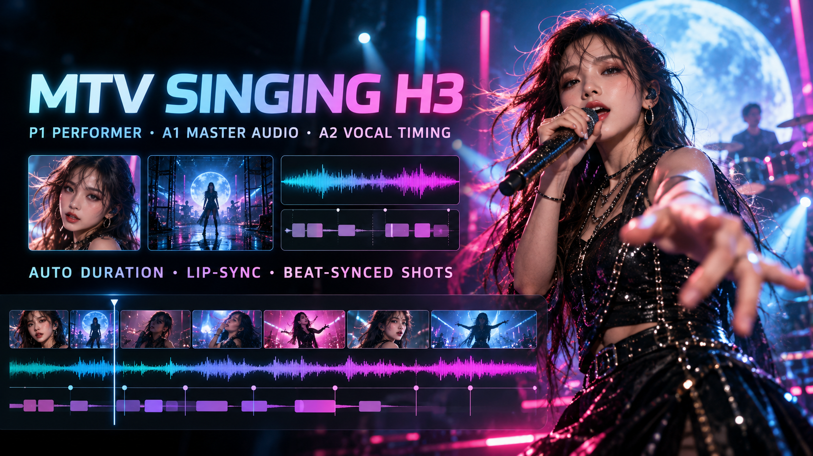

# MTV Singing H3｜完整歌曲自动时长、对嘴与卡点镜头

适用版本：`MiniMax H3 Director Cut Studio v0.3.6-alpha2`

`MTV Singing H3`不是让H3重新唱一次歌曲，而是让画面严格跟随已经准备好的音乐。P1负责演唱，P2/P3负责陪衬表演，P4固定场景世界；A1保留最终主音频，可选A2只提供更干净的人声嘴形时钟。影片时长自动采用A1的实际可播放长度，适合从十几秒测试扩展到完整MTV。

## 一、素材职责

| 槽位 | 内容 | 规则 |
|---|---|---|
| `P1` | 主唱人物图片 | 唯一主唱身份；正面或四分之三侧面最稳定。 |
| `P2`、`P3` | 配角、乐手或舞者 | 可以反应和表演，但不得抢唱或复制P1嘴形。 |
| `P4` | 场景参考 | 决定整支MTV的地点、灯光、色彩和空间。 |
| `A1` | 原曲或最终Mix | 最终声音与影片时长的唯一权威。 |
| `A2` | 可选的分离人声 | 只控制P1嘴形时间，不进入最终混音。 |
| `P5–P9` | Studio自动生成 | 只作为P4世界的分时环境／灯光状态，不是新演员。 |

如果没有A2，Studio会用A1作为唯一嘴形时间源。如果A1包含较长纯乐器段，建议先用主页`AUDIO SEPARATOR`取得Vocal并放入A2；这样乐器瞬态不会让P1错误张嘴。

## 二、Step by Step

### Step 1｜准备最终音频

1. 先确定你真正要发布的歌曲版本。
2. 不需要分离时，把完整歌曲直接放入`A1`。
3. 需要精确避开纯乐器段时，打开主页`AUDIO SEPARATOR`。
4. 选择原曲并执行`SEPARATE AUDIO`。
5. 分别用`PLAY / STOP`试听Vocal、Music和Mix。
6. 把未改动的原曲／Mix放入`A1`，把分离Vocal放入`A2`。

> A2只是嘴形参考。不要把A2与A1同时当作最终声音播放，否则会产生双重人声、相位和音量问题。

### Step 2｜准备人物与场景

1. 把主唱清晰人物图加载为`P1`。
2. 有配角时分别放入`P2`、`P3`；没有需要时可以不强迫角色入镜。
3. 把目标世界或场景图片放入`P4`。
4. P1最好能看清嘴唇、下颌和眼睛，避免口罩、遮脸、极端侧脸及过小人物。
5. P4应提供明确的光向、色温和空间深度，减少跨镜头背景漂移。

### Step 3｜选择Special Skill

1. 进入`Design`。
2. 选择`MTV Singing H3`。
3. 确认Media Pool中的P/A编号正确。
4. 点击`CREATE DIRECTOR DESIGN JSON`。

Studio会读取A1的实际可播放长度，并自动把Design、Timeline、Shots和P5–P9环境状态扩展到同一个终点；不会继续使用模板里的12秒，也不会在Segment边界重播歌曲开头。

### Step 4｜检查Director Design

生成后重点检查：

- `duration_seconds`是否等于A1长度；
- P1是否是唯一Lead Singer；
- P2/P3是否保持非发声嘴形；
- P4是否持续控制同一个视觉世界；
- 没有凭空新增Lyrics、Dialogue、Voice-over或第二位歌手；
- A2存在时，嘴形时间源是否明确为A2；
- Shots是否从0.00秒连续覆盖到歌曲结束。

确认后点击`APPLY TO H3 WORKSPACE`。

### Step 5｜先做0.2MP Preview

1. 点击`PREVIEW 0.2M`。
2. 优先检查有人声的时间段，而不是只看开场。
3. 确认P1在演唱时保持可见的正面／四分之三侧面。
4. 确认纯乐器段P1没有跟鼓点或伴奏错误对嘴。
5. 确认P2/P3没有复制主唱嘴形。
6. 检查每个Segment边界的音乐是否连续，没有重新从头播放或被截断。

### Step 6｜修正单个Shot

如果某个镜头对嘴条件不好：

1. 在Timeline双击该Shot，打开`SHOT VISUAL EDITOR`。
2. 把P1设置为`On-screen speaker`。
3. 选择清晰的正面或四分之三侧面构图。
4. 把P2/P3设置为`Silent listener`或非发声表演者。
5. 保存后点击`REGENERATE DIRTY`，只重新生成受影响的Segment。

### Step 7｜正式输出

Preview确认后点击`ACCEPT 1.0M`。Studio会使用同一时序与Seed重新生成dirty部分，并装配完整歌曲。最终音频保持A1原曲／最终Mix；A2不会叠加到成片。

## 三、验收清单

- [ ] 影片长度与A1实际可播放长度一致。
- [ ] P1从头到尾保持同一人物身份。
- [ ] 有歌声时P1嘴形跟随A2；没有A2时跟随A1。
- [ ] 纯乐器段没有错误嘴形。
- [ ] P2/P3不抢唱、不复制P1脸孔或嘴形。
- [ ] P4及P5–P9保持同一个场景世界。
- [ ] 音乐跨Segment连续，没有重播、断音或变调。
- [ ] 结尾保留0.5–1.0秒稳定动作，不开启新歌词或大动作。

## 四、常见问题

### P1会跟着纯音乐张嘴

把分离Vocal放入A2。A2存在时，它是唯一嘴形时间源；A1继续负责完整音乐和最终声音。

### 歌曲尾段被截断

检查A1的source-in/source-out。Skill采用A1可播放窗口，不采用旧Timeline或模板时长。

### 配角也在唱

在Shot Visual Editor把配角设成`Silent listener`，然后使用`REGENERATE DIRTY`重新生成相关Segment。

### 歌声走调或男女声改变

不要要求H3重唱。先用SoulX等独立工具完成歌声音色转换，再把验收后的最终MP3作为A1；MTV Skill只负责表演画面、时序和嘴形。

## 五、论坛简介（可直接复制）

> MTV Singing H3会以A1完整歌曲自动建立影片时长、镜头节奏与分段环境，P1是唯一主唱，P2/P3负责非发声陪衬，P4定义统一世界。需要更精确的纯乐器／人声切换时，可把分离Vocal放入A2作为唯一嘴形时钟，而最终成片仍使用未改动的A1原曲或Mix。先用0.2MP检查对嘴，再通过Shot Visual Editor和Regenerate Dirty局部修正，不必重跑整支MTV。
