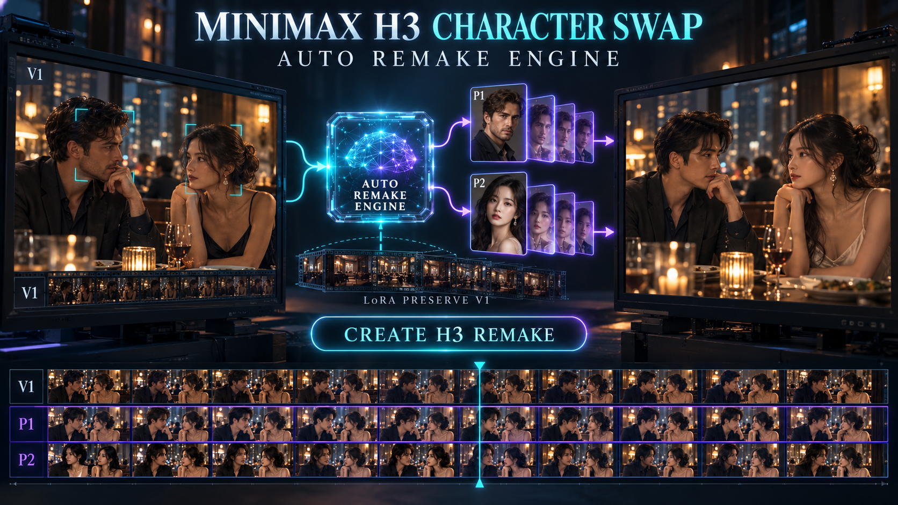

# MiniMax H3 Character-Swap LoRA正式接入：Studio现在会自动选择Remake Engine



适用版本：`MiniMax H3 Director Cut Studio v0.3.7-alpha.1`

这次升级解决的不是“再加一个下拉选项”，而是让Studio自己判断应该使用哪一种影片重制逻辑：

| 你选择的Special Skill | 自动使用的Remake Engine |
|---|---|
| 没有Skill／None | `Create H3 Remake` |
| `Source Video Cast Remake H3` | `LoRA Preserve V1` |
| 其他任何Skill | `Create H3 Remake` |

用户不需要记住哪一个Workflow属于角色替换，也不会因为旧Project保存过另一个模式而误载模型。工具栏会显示只读的`Remake Engine · AUTO`结果。

## 为什么要分成两个Engine？

`Create H3 Remake`适合重新设计画面：Studio把人物、场景、动作、声音与Skill规则编译为新的H3影片。

`LoRA Preserve V1`的目的不同：它把V1当成真实的动作、镜头、场景与时间底板，通过`MiniMax-H3-Character-Swap-LoRA v1.5`和`H3 Relay`替换已经绑定的主要角色，同时尽量保留：

- 表演动作与身体姿态；
- 表情及说话时间；
- 运镜、景别、构图与遮挡；
- 原本的背景、光线和空间；
- Shot边界与剪辑节奏；
- V1原声、现场声、音乐和对白时钟。

所以它不是把P图片贴在脸上，也不是先分析V1后凭文字重新猜一次。Studio会按Shot准备24fps Relay片段，再由LoRA和H3进行角色重合成。

## 多角色替换怎样工作？

V1分析完成后，每一次主要人物出场都会成为独立时间卡。你可以：

- 只加载P1，让多个时间卡复用P1；
- 加入P2–P9，为不同角色指定不同演员；
- 同一人物在后段改用另一张P图；
- 选择`V1 DEFAULT`保留某次出场的源演员；
- 对卡通／漫画P人物开启`ILLUSTRATED CAST → LIVE-ACTION CINEMA`，保留身份特征但重塑为真人电影质感。

多角色Shot会按角色Pass逐一处理。Studio不会因为有四名角色就把同一条完整影片无意义地重做四次；只对真正出现的角色和对应Shot执行必要Pass。

## Server需要安装什么？

项目已经包含API Workflow：

```text
akatz-labs-character-swap-turbo8-adaptive-window-api.json
```

Server端需要：

| 档案／组件 | 安装位置 |
|---|---|
| ComfyUI `0.32+` | ComfyUI主程序 |
| 当前`akatz-ai/h3-relay` | `ComfyUI/custom_nodes/h3-relay/` |
| `h3_character_swap_v1.5.safetensors` | `ComfyUI/models/loras/` |
| `minimax_h3_fl2v_turbo_8step_v1.0_comfyui_bf16.safetensors` | `ComfyUI/models/loras/` |
| `minimax_h3_ref2va_pruned_int8_convrot.safetensors` | `ComfyUI/models/diffusion_models/` |
| `qwen3vl_32b_minimax_h3_nvfp4_awq.safetensors` | `ComfyUI/models/text_encoders/` |
| `minimax_h3_video_vae_fp16.safetensors` | `ComfyUI/models/vae/` |
| `minimax_h3_audio_vae_fp32.safetensors` | `ComfyUI/models/vae/` |
| `ffmpeg`与`ffprobe` | Windows PATH |

安装重点：关闭ComfyUI后安装当前`h3-relay`主分支；如果曾经另装旧版`labs-video-prep`，应移除重复副本。重新启动后，节点列表必须出现`LabsH3PrepareVideo`与`H3RelayWindowedEdit`，Loader也必须找到上表所有文件。

副机不需要模型，只需要能够连接这台Server的ComfyUI API。

## Step by Step

1. 把有权二创的影片加载为V1。
2. 至少加入一张人物图P1；其他人物图按需要加入。
3. 选择`Source Video Cast Remake H3`。
4. 查看顶部是否自动变成`LoRA Preserve V1`。
5. 进入Design，执行Qwen V1分析。
6. 在每张角色时间卡选择P图或`V1 DEFAULT`。
7. Create Director Design JSON。
8. Apply to H3 Workspace。
9. 先做0.2MP Preview，检查换人、口型、听众闭嘴、场景与Shot边界。
10. 执行`RUN + QUEUE`完成正式输出。
11. 以后只修改某个Shot时，使用`REGENERATE DIRTY`局部重做。

第一次完整正式输出完成后，Studio会把全部Production Segment记录为clean基线。后续单Shot修改不会再强迫整片重新Preview和Accept。

## 怎样确认没有走错Engine？

- 选择`Source Video Cast Remake H3`：显示`LoRA Preserve V1`。
- 选择None、MTV、Talk Show、4DX或其他Skill：显示`Create H3 Remake`。
- 切换Skill时显示会立即更新。
- 旧Project即使保存过手动模式，载入后也会按当前Skill重新计算。

## 注意事项

- 只处理你拥有或得到授权二创的源影片与人物肖像。
- Character-Swap LoRA上游建议使用清晰、连续、24fps的短片段；复杂遮挡、大幅度转身、快速切镜与极小脸孔仍可能需要拆Shot或局部重生。
- 模型、代码、MiniMax H3权重与源影片的许可彼此独立，商用前请逐项确认。

项目参考：

- [MiniMax-H3-Character-Swap-LoRA](https://huggingface.co/akatz-ai/MiniMax-H3-Character-Swap-LoRA)
- [h3-relay](https://github.com/akatz-ai/h3-relay)

一句话总结：**现在不需要手动猜Engine。普通创作走Create H3 Remake；选择Source Video Cast Remake H3，就自动走LoRA Preserve V1。**

