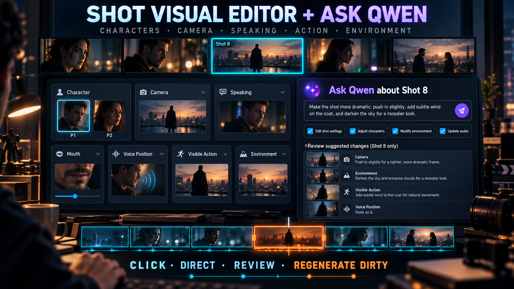

# Shot Visual Editor + Ask Qwen｜直接在Timeline完成局部导演修正



适用版本：`MiniMax H3 Director Cut Studio v0.3.6-alpha.2`

`Shot Visual Editor + Ask Qwen`把“修改一个镜头”从整段Prompt重写，改成可点击、可审查、可撤销的导演工作流。你可以直接在Timeline打开Shot，调整人物、镜头、发声状态、嘴形、声音方位、动作与环境；也可以用自然语言告诉Qwen想要的结果，只允许它提出指定范围的结构化Patch。保存后，Studio只把相关Segment标记为dirty，不会要求整部影片从头生成。

## 一、这个功能解决什么问题

| 旧做法 | Shot Visual Editor + Ask Qwen |
|---|---|
| 在长Prompt里寻找需要改的句子 | 双击Shot，直接编辑结构化卡片 |
| 为了改一个镜头重新跑完整影片 | `REGENERATE DIRTY`只重生受影响Segment |
| Qwen自由重写Prompt，难以知道改了什么 | 先显示字段级Patch，再由用户选择Apply或Reject |
| 画外音让画面人物错误张嘴 | 明确设为`Silent listener`、`Off screen`或`Behind camera` |
| 换一个演员时前后镜头身份漂移 | 选择当前Shot、连续镜头或全部出现位置的Identity Scope |
| 改完后无法回退 | 编辑和关联修复合并为一次Undo |

## 二、Shot Visual Editor可以控制什么

- `Character`：查看当前Shot中的全部角色；解锁后可逐个绑定Media Pool里的P Picture。
- `Camera`：调整Framing、Camera Angle、Camera Movement、Speed与Amplitude。
- `Speaking`：选择`On-screen speaker`、`Silent listener`或`No human voice`。
- `Mouth`：限制嘴唇、下颌及非发声表情，例如自然闭嘴、只眨眼和呼吸。
- `Voice Position`：选择`Auto`、`On screen`、`Off screen`、`Behind camera`或`Non-diegetic`。
- `Visible Action`：控制画面可见动作和人物反应。
- `Environment`：控制天气、光线、空间及物理环境反馈。
- `Advanced`：需要核对时才展开原始／编译文字，平时保持隐藏。

Character默认`Identity locked`，避免误触换人。点击`Unlock All Characters`后，当前Shot中的每个角色都会独立出现；你可以只替换一人，也可以一次替换全部角色。多角色互换采用原子映射，因此`P1→P2`和`P2→P1`可以在同一次保存中安全完成。

## 三、Step by Step

### Step 1｜从Timeline打开目标Shot

1. 打开已经建立Timeline的Project。
2. 在Timeline双击需要修改的Shot。
3. 顶部缩略图会同时显示相邻Shot；点击其他缩略图可快速切换检查连续性。
4. 先确认Shot编号、时间范围和当前可见人物正确。

### Step 2｜直接调整导演卡片

按需要修改Character、Camera、Speaking、Mouth、Voice Position、Visible Action或Environment。

例如，声音来自镜头后方，但画面里的P2必须闭嘴：

```text
Speaking: Silent listener
Mouth: lips naturally together; no speech articulation; blink and breathe only
Voice Position: Behind camera
Visible Action: P2 listens and reacts with the eyes only
```

这些结构化事实会在H3 Prompt编译时高于旧式关键词猜测，因此不需要把“闭嘴”重复塞进多段文字。

### Step 3｜需要时解锁并替换人物

1. 在Character卡片点击`Unlock All Characters`。
2. 为每个角色选择实际存在的P Picture。
3. 选择Identity Scope：

| Identity Scope | 适用情况 |
|---|---|
| `This Shot only` | 只想改变当前镜头。 |
| `Linked continuity Shots` | 同一动作或空间需要前后镜头保持一致。 |
| `All appearances of this role` | 整条Timeline都要换成同一演员。 |

Studio会同步角色绑定、H3参考及受影响Segment，不会把人物参考图平贴进Program Monitor。

### Step 4｜用Ask Qwen描述想要的结果

右侧`Ask Qwen about Shot`适合处理需要推理的修改。例如：

```text
让画面的P2闭嘴，只用眼神回应。声音来自镜头背后，保留原始对白、
人物身份和时间，并检查下一镜的视线连续性。
```

或：

```text
加入一次由远处落雷引起的窗户闪光、人物惊吓和短促室内反射，
不要改变对白、人物、时长和下一镜站位。
```

只勾选允许Qwen处理的范围：

- `Performance`
- `Audio Position`
- `Camera`
- `Character Identity`

未授权字段不会交给Qwen修改。

### Step 5｜检查Qwen Patch

点击`Generate suggestion`后，Qwen不会直接覆盖影片。Studio会先列出：

- 目标Shot／Text Layer／Track；
- 被修改的字段；
- 原值和建议值；
- 修改原因；
- 风险等级。

取消不需要项目的勾选，再点击`APPLY SELECTED`。如果建议不合适，点击`REJECT`，Project不会改变。对白原文、Speaker、Language、时间、Track及Generation Work Area属于高影响项目，套用前会再次确认。

### Step 6｜选择保存范围

| Repair scope | 行为 |
|---|---|
| `Shot Only` | 只保存当前Shot，使覆盖它的Segment失效。 |
| `Linked Continuity` | 默认选择；同时检查前后Shot的环境、视线和动作交接。 |
| `Whole Segment` | 天气、空间、节奏等整体变化需要重算完整Segment时使用。 |

点击`Save Shot`后，Studio保留旧成片，只把真正受影响的Segment标记为dirty。

### Step 7｜从Timeline调用全局Ask Qwen

Timeline标题栏的`ASK QWEN`可以处理更大的范围：

1. `Selected Shot`
2. `Linked Continuity`
3. `Whole Segment`
4. `Generation Work Area`
5. `Whole Timeline`

它适合检查“这个特效会不会影响下一镜”“所有画外音人物都要闭嘴”“把整段运镜统一”等跨Shot问题。它同样只返回可审查Patch，不会跳过用户确认直接重写完整Prompt。

### Step 8｜只重新生成dirty Segment

保存后，Generation工具栏会显示橙色`REGENERATE DIRTY`及dirty数量：

1. 点击`REGENERATE DIRTY`。
2. Studio自动定位所有dirty Segment，不需要手填Work Area时间。
3. 自动执行`PREVIEW 0.2M`；clean Segment直接复用缓存。
4. 检查人物、动作、对嘴、声音方位、环境和边界连续性。
5. Preview满意后点击`ACCEPT 1.0M`，以相同Seed重生dirty部分并装配完整Final Master。

保存并重新打开Project后，Studio仍会读取Preview／Production manifest及Workspace Segment Takes，所以修改一个Shot不会因为重新载入Project而从头生成整片。

## 四、推荐工作流程

```text
双击Shot
→ 点击卡片完成明确修改
→ 用Ask Qwen处理需要推理的部分
→ Review Patch
→ Save Shot
→ REGENERATE DIRTY
→ PREVIEW 0.2M检查
→ ACCEPT 1.0M完成
```

原则很简单：能够直接点选的事实由用户控制，需要理解因果与连续性的部分交给Qwen建议，最终改动必须经过Review。

## 五、验收清单

- [ ] 当前Shot的人物身份和数量正确。
- [ ] 发声者、静默听众和画外音位置正确。
- [ ] 非发声人物没有错误嘴形。
- [ ] Camera只有一个明确的主要运动。
- [ ] 动作能够在Shot时长内完成。
- [ ] 环境变化与前后Shot具有因果和连续性。
- [ ] Qwen只修改了已授权字段。
- [ ] 高影响Text Layer／时间修改已经人工确认。
- [ ] `REGENERATE DIRTY`只提交被修改Segment。
- [ ] 0.2MP Preview通过后才执行1.0M正式生成。

## 六、常见问题

### 为什么Character一开始不能更改？

Character默认锁定是为了防止误触造成整片身份漂移。点击`Unlock All Characters`后即可更换一个或全部角色，并选择影响范围。

### Qwen会不会偷偷改完整Prompt？

不会。Qwen只能返回白名单字段的结构化Patch；未知对象、未授权字段及重复修改会被本地拒绝。

### 为什么看不到REGENERATE DIRTY？

只有保存后的修改真正使既有Segment失效时才显示。若没有dirty Segment，按钮会隐藏，避免无意义重生。

### 修改Shot后会不会自动修复关联镜头？

选择`Linked Continuity`时会检查前后Shot，并同步明确的环境入／出状态；不会静默改写无关人物、对白或素材。

### 可以撤销吗？

可以。一次手动编辑、人物映射、Qwen Patch及必要关联修复会进入同一个Undo事务，可整体撤回。

## 七、论坛简介（可直接复制）

> Shot Visual Editor + Ask Qwen让MiniMax H3影片可以像剪辑软件一样局部导演：双击Timeline Shot，直接点击人物、镜头、发声、嘴形、声音位置、动作和环境卡片；复杂修改则用自然语言交给Qwen提出结构化Patch，再逐项Review和Apply。保存后只标记相关Segment为dirty，点击REGENERATE DIRTY便自动完成0.2MP局部预览，确认后以1.0M装配完整Final Master，不必为了改一个镜头重跑整部影片。
