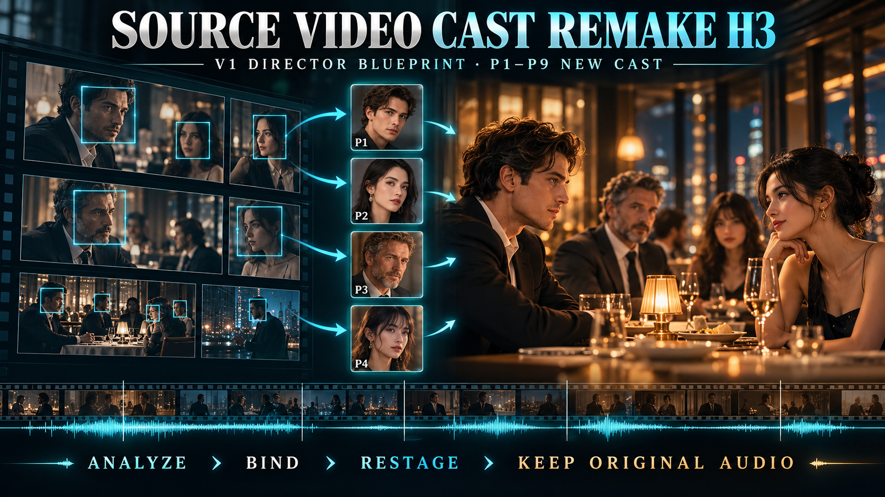

# Source Video Cast Remake H3｜分析V1导演语法，再由P演员重演

适用版本：`MiniMax H3 Director Cut Studio v0.3.7-alpha.1`

`Source Video Cast Remake H3`不是传统贴脸换脸。Studio先把V1分析成人物、Shot与原声账本，再自动选择`LoRA Preserve V1`：把逐Shot、24fps的V1片段送进H3 Relay，以Character-Swap LoRA v1.5替换绑定的P1–P9人物，同时保留源动作、镜头、背景与时间。最终声音恢复为V1未经修改的原声。

> 只使用你拥有或获授权二创的源影片。

## 一、素材职责

| 槽位 | 内容 | 规则 |
|---|---|---|
| `V1` | 有权二创的源影片 | Design阶段用于分析；生成阶段只以逐Shot Relay片段作为LoRA Preserve V1的运动／场景底板。 |
| `P1` | 最低必需替换演员 | 只有一张P1也能开始；所有角色卡默认复用P1。 |
| `P2–P9` | 可选演员池 | 加载后可在人物时间卡中按需指定，不要求凑满四张。 |
| V1原声 | 对白、音乐、环境与节奏 | 每个Segment切出同一时间窗，最终恢复未经修改的Master Audio。 |

## 二、开始前检查

1. LM Studio Server已经启动，并能访问Design设置中的`/v1`地址。
2. 已加载指定的Qwen视觉模型，例如`qwen3.8-uncensored-nvfp4-mtp`。
3. V1可以正常播放，时长和内嵌声音已经识别。
4. 每张P演员图都能清楚辨认脸孔、发型和服装。
5. ComfyUI H3 Server可连接。

## 三、Step by Step

### Step 1｜把源片与演员放进Media Pool

1. 把源影片加载为`V1`。
2. 至少加载一张替换演员图为`P1`；这已经足够完成Design与Apply。
3. 如果想让不同角色使用不同外貌，再按需加入P2至P9；不需要凑满四张。
4. 不要把V1重复加载成普通Video Reference。

### Step 2｜选择Special Skill

1. 进入`Design`。
2. 选择`Source Video Cast Remake H3`。
3. 确认顶部只读`Remake Engine · AUTO`显示`LoRA Preserve V1`。
4. 确认V1与P图片在Media Pool Intelligence中可见。
5. 点击`CREATE DIRECTOR DESIGN JSON`。

### Step 3｜等待Qwen完整分析V1

Studio会完成以下工作：

1. 读取V1完整时长和真实场景边界；
2. 为每个场景建立early／late／midpoint分析帧；
3. 生成最多三张清晰的带时间标签Storyboard；
4. 由Qwen建立地点、事件、动作交接、发声者、听众、镜头和连续性账本；
5. 把每一次主要人物出场变成独立的正方形脸孔时间卡。

长片分析采用紧凑32K结构化输出和独立30分钟时限。JSON漏逗号、输出不完整或分析worker意外退出时，Studio会自动进行一次紧凑重试。不要在分析期间重复点击Design或关闭Studio。

### Step 4｜逐张绑定人物时间卡

分析完成后，`V1 PRINCIPAL ROLE BINDINGS`会按源片时间排列：

1. 每行显示6张正方形卡片。
2. 每张卡只代表一个独立出场时间。
3. 同一源人物的卡片最初会采用相同建议P图，但建立后不会锁定或联动。
4. 在`REPLACE WITH`中选择P1–P9。
5. 可以让多个时间卡复用同一P图。
6. 如果某次出场要保留原演员，选择`V1 DEFAULT · Keep source actor`；Studio会把该时间点的正方形脸孔裁切物化为新的P身份参考。这个选择只影响当前时间卡，不会锁定或同步同一角色的其他出场卡片。
7. 滚到最下方，确认最后一排及ready状态完整显示。

人物绑定以“源角色＋场景时间”为单位，因此后段可以故意换成另一张P图，而不会误改前段。

### Step 5｜重新建立Director Design JSON

完成全部人物绑定后，再点击一次`CREATE DIRECTOR DESIGN JSON`。检查：

- 所有V1主要角色都有明确P绑定；
- `media_requests`没有自创人物图或场景替代图；
- V1在Design JSON中标记为`analysis_only`；实际生成时由Studio另行准备Shot-local Relay plate；
- Shot顺序与V1事件顺序一致；
- 每个Shot只写实际出现的P人物；
- `text_layers`为空，没有转录、翻译或新对白；
- 总时长等于V1真实可播放时长。

### Step 6｜通过Preflight并Apply

点击`APPLY TO H3 WORKSPACE`。如果Preflight提示缺少P图或角色账本，不要强行继续：

- 缺少P图：回到绑定卡选择已经加载的P图片；
- 缺少principal-role ledger：确认Qwen API在线后重新运行V1分析；
- 指定P4/P5未使用：只在对应V1角色确实存在时建立绑定。

### Step 7｜先做0.2MP Preview

1. 点击`PREVIEW 0.2M`。
2. 检查每次角色交接是否与V1相同。
3. 检查V1场景、建筑、主要物件、光向、构图与运镜是否被保留，没有被普通Creative Prompt重塑。
4. 检查当前说话角色是否跟随对应V1原声音素。
5. 检查听众和群众是否保持非发声嘴形。
6. 检查切镜节奏与原声是否同步。

### Step 8｜局部修正而不是重跑整片

如果某个Shot人物、闭嘴状态、构图或动作不正确：

1. 在Timeline双击该Shot。
2. 在`SHOT VISUAL EDITOR`修改人物、Speaking、Mouth、Camera、Action或Environment。
3. 需要Qwen协助时，只勾选允许它改变的字段。
4. 保存后点击`REGENERATE DIRTY`。
5. Studio只重新生成受影响Segment，并复用已有clean片段。

### Step 9｜正式输出

Preview确认后点击`ACCEPT 1.0M`。Studio用完整分辨率重新生成dirty片段，装配全片并恢复V1未经修改的内嵌原声作为唯一Master Audio。

## 四、验收清单

- [ ] V1在Design中只作`analysis_only`；运行时仅使用Studio准备的Shot-local Relay plate。
- [ ] 所有主要人物时间卡已经绑定。
- [ ] P演员没有互换、混脸、复制或被V1原演员覆盖。
- [ ] 每个Shot只加载真正出场的P人物。
- [ ] 保留V1事件次序、动作因果、镜头目的与剪辑节奏。
- [ ] V1场景、拓扑、物件、群众、光向与运镜保持，只有绑定演员身份被替换。
- [ ] 只有当前发声人物对嘴；听众保持闭嘴反应。
- [ ] 没有新增对白、旁白、歌词或替代音乐。
- [ ] 最终声音为V1原声，总时长与V1一致。

## 五、常见问题

### `Qwen3.8 analysis stopped`

先确认LM Studio API地址可以打开并已加载正确模型。v0.3.6-alpha.2会区分JSON损坏、HTTP失败与worker timeout，自动进行一次紧凑重试；第二次失败时会保留明确原因。

### 出来的画面只是重复V1

确认Skill确实是`Source Video Cast Remake H3`，顶部Engine为`LoRA Preserve V1`。Design JSON中的V1应为`analysis_only`，运行时则由Studio自动准备24fps Relay Shot；不要手工把完整V1再塞入普通Video Reference槽。

### 人物没有按照人物卡绑定替换

不要只在Media Pool放入图片；必须在每一张V1人物时间卡的`REPLACE WITH`中确认P绑定，再重新创建Director Design JSON。

### Preview对嘴但Full输出不对

检查Full是否复用了旧Segment。修改Shot后使用`REGENERATE DIRTY`，确认受影响Segment重新生成，再执行`ACCEPT 1.0M`。

## 六、论坛简介（可直接复制）

> Source Video Cast Remake H3先用Qwen分析全片人物出场、发声与Shot边界，再把每次人物出场显示为独立脸孔时间卡，让用户逐张绑定P1–P9。选择该Skill后Studio自动进入LoRA Preserve V1，以逐Shot 24fps Relay底片保留V1动作、镜头、背景、时序和原声，只替换映射演员。人物或镜头需要调整时，可直接用Shot Visual Editor与Regenerate Dirty局部重做。
